# Competitive Research Agent with Claude, LangGraph and Source Verification

An agent that researches the competition for a business idea. It finds competitors, reads their websites, pricing pages and customer reviews, and returns a report in which every claim cites the page it came from and a verbatim quote. Code checks each quote against the fetched page, and anything that can't be confirmed is flagged instead of presented as fact. The report ends with market gaps, and each gap may only cite verified evidence.

The hard part isn't calling a model. It's making the output trustworthy enough to act on: verification that the model can't talk its way past, an eval that measures whether the citations actually hold up, and a pipeline that runs for one to two minutes per report without blocking anyone.

**Stack:** Python · FastAPI · LangGraph · Claude API (Haiku / Sonnet / Opus 5.5) · Exa · Celery · Redis · PostgreSQL · SQLAlchemy · Alembic · Next.js 16 · TypeScript · MCP · Langfuse · Docker · Terraform · AWS (ECS Fargate, RDS, ALB, ECR, Secrets Manager, Cloud Map, CloudWatch)

## At a glance

| | |
| --- | --- |
| **What it does** | Turns "what I want to build" into a sourced competitor report: products, pricing, positioning, customer praise and complaints, and market gaps. |
| **Trust mechanism** | Every claim carries a URL and a verbatim quote. Code confirms the quote is on that page. Gap analysis only sees confirmed facts. |
| **Evaluation** | 15 human-reviewed cases. Citation support 0.555, quote-found rate 0.989, competitor recall 0.568, all gaps grounded. Judged by Claude Sonnet 5.5. |
| **Interfaces** | Web app, REST API, MCP server (used from Claude Desktop) and CLI. |
| **Cost control** | Model picker with per-model capability and cost hints, cheapest by default. A 6-competitor report costs about $0.02 on Haiku (estimated) and $0.94 on Opus (measured). |
| **Tests** | 38 offline tests (Claude, Exa and Postgres faked). Free to run. |
| **Deployed** | AWS ECS Fargate (arm64), RDS PostgreSQL and an ALB, all from Terraform: 29 resources, one-command deploy and teardown. |

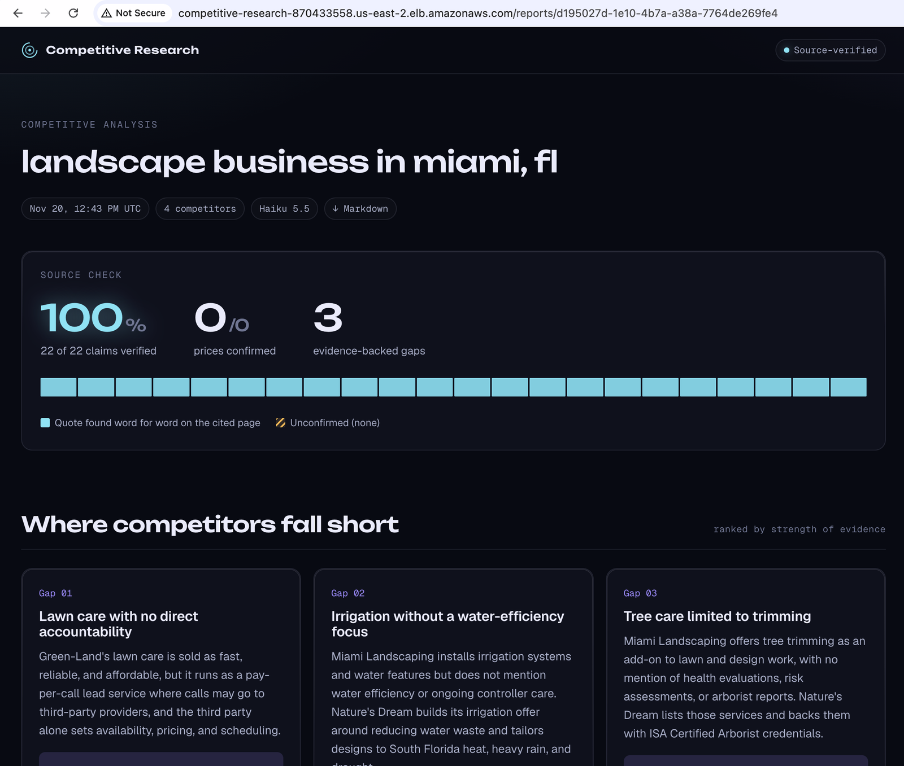
<sub>A report served from the AWS deployment. Each segment of the strip is one claim. Cyan means its quote was found word for word on the cited page; hatched amber means it couldn't be confirmed.</sub>

## Contents

- [The problem](#the-problem)
- [Quick start](#quick-start)
- [Architecture](#architecture)
- [Key decisions and trade-offs](#key-decisions-and-trade-offs)
- [Engineering decisions](#engineering-decisions)
- [Evaluation](#evaluation)
- [What testing caught](#what-testing-caught)
- [Testing](#testing)
- [Observability](#observability)
- [Deployment on AWS](#deployment-on-aws)
- [Using it from Claude (MCP)](#using-it-from-claude-mcp)
- [Limitations and next steps](#limitations-and-next-steps)
- [Repository map](#repository-map)

Full operating instructions are in [docs/RUNNING.md](docs/RUNNING.md).

## The problem

Anyone starting a business, a product or a channel needs to know who they're up against, what those competitors charge, and where the openings are. Doing it properly takes days of searching and reading. A chatbot answers in seconds, but it invents details and rarely shows where a claim came from, so the answer isn't something to spend money on.

Asking the model to "cite sources" doesn't solve this. A model can attach a real URL to a claim the page never makes, or paraphrase a page into something stronger than what it says. The citation has to be checked by something other than the model that wrote it.

## Quick start

```bash
cp .env.example .env              # set ANTHROPIC_API_KEY and EXA_API_KEY
docker compose up -d --build      # Postgres, Redis, API, worker, web, MCP
```

| URL | What's there |
| --- | --- |
| http://localhost:3001 | Web app: start research, follow progress, read reports |
| http://localhost:8000/docs | API docs |
| http://localhost:8001/mcp | MCP server |

```bash
docker compose run --rm api python -m pytest -q tests    # 38 tests, no API keys needed
```

Each research run calls Claude and Exa. With the default model, Haiku 5.5, a 6-competitor report is estimated at about two cents.

## Architecture

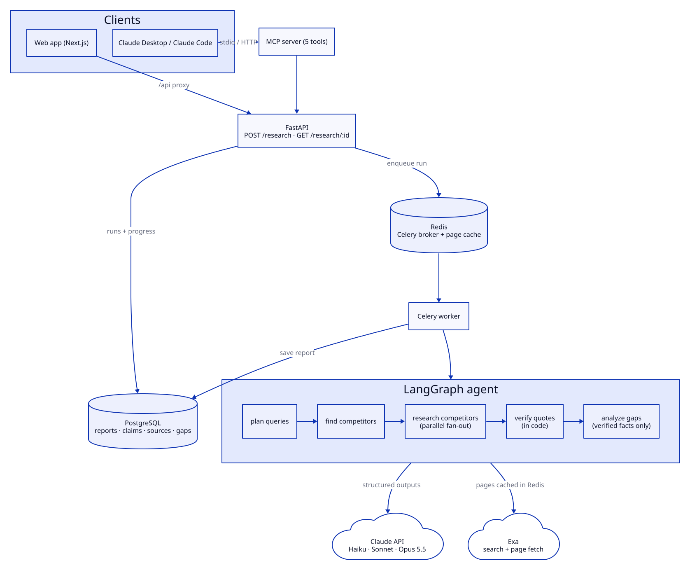

| Component | Role |
| --- | --- |
| **Web app** (`web/`) | Next.js 16 and TypeScript. Server components read from the API. The browser goes through a `/api` proxy, so it never needs the backend's address. |
| **API** (`src/app/routes/`) | FastAPI. `POST /research` returns 202 with a run ID. `GET /research/{id}` returns status, step-by-step progress and, when done, the report. `GET /models` serves the model list. |
| **Worker** (`src/app/tasks.py`) | Celery. Runs the agent, writes progress to Postgres after every graph step and saves the finished report. Acknowledges tasks late, so a crashed worker's run is redelivered. A finished run is never redone. |
| **Agent** (`src/app/research/pipeline.py`) | LangGraph: plan → find competitors → research each competitor in parallel → verify → analyze gaps. |
| **Verification** (`src/app/research/verify.py`) | Deterministic quote matching against the fetched page text. |
| **Storage** (`src/app/models.py`) | PostgreSQL via SQLAlchemy 2 and Alembic. Six tables: reports, competitors, sources, claims, price plans and market gaps. Claims link to their stored source page. |
| **Page cache** (`src/app/research/cache.py`) | Redis cache of fetched pages (24 h). Repeat research skips repeat Exa requests. If Redis is down, pages are fetched directly. |
| **MCP server** (`src/app/mcp_server.py`) | Five tools over the same HTTP API, so it gets the same validation as the web app. |

### How a report is built

1. **Plan.** Claude writes 3–5 search queries that describe what a competitor would look like.
2. **Find.** Exa's company search returns candidates, de-duplicated by domain. Claude picks the real competitors. Any URL that wasn't in the search results is dropped, so the model can't invent a company.
3. **Research, in parallel.** For each competitor, Exa fetches the homepage, the pricing and feature pages, and third-party reviews from G2, Capterra, TrustRadius, Trustpilot, Product Hunt and Reddit. A review page counts only if it names the company. Claude extracts claims and price plans with Pydantic structured outputs, each with a source URL and a verbatim quote.
4. **Verify.** Code checks every quote against the cited page's text. Prices must also have their numbers in the quote.
5. **Analyze gaps.** Claude sees only verified claims, each with an ID, and must cite IDs for every gap. Unknown or unverified IDs are removed in code. A gap left with no evidence is shown as unconfirmed.

## Key decisions and trade-offs

| Decision | Instead of | Why |
| --- | --- | --- |
| Verify quotes in code by normalized substring match | Asking the model whether its own citations are right | Deterministic, free and auditable. A model grading itself can be persuaded; a string match can't. |
| Gap analysis sees only verified claims, with IDs checked in code | Free-form analysis over everything extracted | Every conclusion traces to a confirmed quote. Invented evidence IDs are removed, not trusted. |
| LangGraph with `Send` fan-out, one branch per competitor | A sequential loop | Competitors are researched in parallel. One failed site doesn't sink the report. Graph updates drive the per-step progress UI. |
| Async runs (Celery) with progress in Postgres | One long HTTP request | Runs take 1–2 minutes. Clients poll a cheap `GET`, and progress survives API restarts. |
| Pydantic structured outputs | Parsing JSON out of prose | Responses validate against the schema or fail loudly. No regex repair. |
| A single model list, cheapest model by default | One hard-coded model | Haiku costs about 1/40 of Opus per competitor. Users choose quality against cost, with the trade-off shown before they run. |
| A different model (Sonnet 5.5) judges citations in the eval | The agent's own model | Avoids the model grading its own work. |
| MCP server calls the HTTP API | MCP reading the database directly | One code path with the same validation, and the MCP server holds no credentials. |
| Fargate in public subnets, IP-restricted ALB, no NAT gateway | Private subnets with NAT, plus a login | A short-lived demo for about $0.15/hour. The IP allow-list stands in for authentication; see [Limitations](#limitations-and-next-steps). |

## Engineering decisions

### Verification the model can't argue with

`verify.find_quote` normalizes both the quote and the page text before matching. It lowercases, decodes HTML entities, removes Markdown and link syntax, unifies curly quotes and dashes, and collapses whitespace. Quotes may skip text with `...`, as long as the fragments appear in order. Quotes under 12 characters can't be verified, so a vague one-word quote can't pass. Each claim keeps a note explaining why it passed or failed, for example `quote not found on cited page` or `cited page was not fetched`.

The check proves a quote **exists** on the page. It doesn't prove the quote **supports** the claim. That gap is what the eval measures.

### Model choice without surprise bills

`src/app/research/models.py` is the single list of models. The API, worker, MCP server, CLI, eval runner and web app all read from it. Each model has a capability hint, token prices and a cost per competitor. The Opus figure is measured from the eval baseline; Haiku and Sonnet are scaled by price and labelled as estimates in the UI. The chosen model is stored on the run and applied through a context variable, which LangGraph copies into its worker threads, so every parallel branch uses it. A test checks this.

Claude Haiku 5.5 has no server-side refusal fallback, and sending the fallback parameter to it returns a 400. Each model entry records whether it supports the fallback, and a test covers each model.

### Progress you can watch

The worker streams the graph's updates (`stream_mode=["updates", "values"]`) and turns each finished node into a progress event. That includes one event per competitor branch, which the web app shows as "researching 3/6". Progress is written to Postgres, not held in memory, so any API instance can serve it.

## Evaluation

Fifteen business ideas across B2B SaaS, dev tools, consumer, marketplace, vertical SaaS, hardware, fintech and health. Each has 3–5 well-known competitors that a good report should find, and each list was reviewed by a human. The runner calls the real agent and records cost, tokens and latency. Failed attempts go to an error log rather than being scored as zero, runs resume where they stopped, and the runner refuses to run if the eval code changes without re-approval.

| Metric | What it measures | Baseline (Opus 5.5, 15 cases) |
| --- | --- | --- |
| **Citation support** | Share of verified claims whose quote, on its own, backs the whole claim. Judged by Sonnet 5.5 as supported, partial or unsupported. | **0.555** ± 0.021 |
| Quote found | Share of claims whose quote is on the cited page | 0.989 ± 0.008 |
| Competitor recall | Share of the expected competitors the report found | 0.568 ± 0.145 |
| Gap grounding | Share of gaps backed by verified evidence | 1.000 |

The full run cost $15.66 ($13.87 agent, $1.79 judge) and took 10 minutes. The median report took 88 s. Before the full run, the judge was checked on known answers: it rejected an empty quote, "I don't know" and an off-topic quote, marked an overreaching claim "partial", and passed an exact match.

**What the baseline shows:**
- **Claims overreach their quotes.** About 45% of verified claims are "partial": the claim bundles more facts than the one short quote it cites. For example, the quote *"Sentry supports over 100 programming languages and frameworks"* was cited for a claim that added *"including iOS and Android."* The quote check can't see this; the judge can.
- **Recall misses market leaders.** For "AI sales-call notetaker", the agent found none of Gong, Otter, Fireflies or Fathom and picked smaller vendors instead. Exa's company search surfaces long-tail companies, and nothing in the selection step favours incumbents.

Both are the next things to fix, and the eval can measure the improvement. Details are in [metrics.md](.claude/hillclimb/research-report/metrics.md).

## What testing caught

| Problem | Found by | Fix |
| --- | --- | --- |
| Exa returns subpages as plain dicts, which crashed the site fetch | First real run | Read both shapes |
| Review search returned pages about *other* companies ("Smartnotation" for "Smartnote") | Inspecting a real report | Review pages must name the company as whole words in the title or URL |
| Page text was HTML-escaped in the prompt, so Claude quoted `&amp;` and correct claims were flagged | 3 false flags in a real run | The quote check decodes HTML entities |
| Judge cost showed $0.00 | Eval pilot ("a zero is a bug") | Thread pools don't inherit context variables; copy the context per job |
| Langfuse counted every Claude call twice | Comparing trace counts with call counts | Filter out the Anthropic SDK's own spans |
| Haiku 5.5 rejects the refusal-fallback parameter | Reading the model's migration notes | Per-model fallback setting, with a test per model |
| The k6 load test posted to `/research`, which would have queued thousands of paid runs | Review after runs became async | The load test now hits only the read endpoints |
| AWS rejected a security-group description containing `>`, and the deploy wrapper hid the failed exit code | First `apply` | Fixed the description; the wrapper now propagates failures |
| The organization's service control policy denies compute in every region except us-east-2 | Read-only checks across regions | Deploy to us-east-2 |

## Testing

38 tests, all offline, with Claude and Exa faked and SQLite in place of Postgres:

| Area | What's proven |
| --- | --- |
| Verification | Markdown, smart quotes, HTML entities and `...` fragments still match; paraphrases and too-short quotes are rejected |
| Agent graph | Invented competitor URLs dropped; unverified claims kept out of gap evidence; one failing competitor doesn't sink the report; usage recorded across parallel branches |
| Service | Report saved and loaded back identical; progress events in order; Celery task success, failure and redelivery; API validation; page cache |
| Models | The run's model reaches every Claude call; fallback parameter only sent where supported; API default and validation; Haiku long-prompt pricing |
| MCP | All five tools through the real API; errors readable by clients; `start_research` never starts a paid run in tests |
| Eval harness | Recall matching, judge scoring, cost maths, unapproved-harness refusal, failed attempts not scored as zero, resume |

## Observability

Self-hosted Langfuse (`docker compose --profile tracing up -d`) records one trace per research run: a span per graph node, a generation per Claude call with model and token usage, and a tool span per Exa request. Every run also stores a usage summary on the report itself: models, calls, tokens, Exa requests, latency and the trace link. In AWS, container logs go to CloudWatch.

## Deployment on AWS

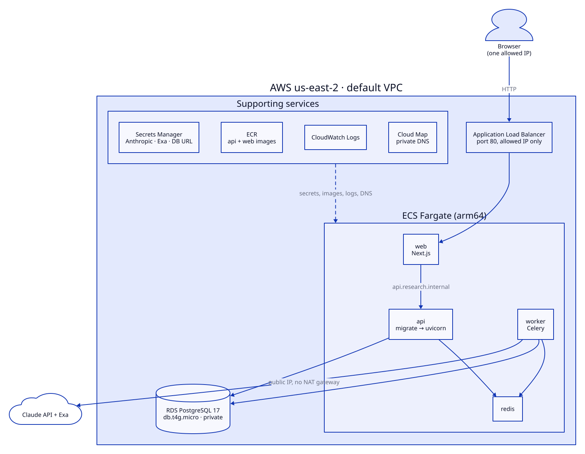

| Concern | Choice |
| --- | --- |
| Compute | ECS Fargate, arm64 (Graviton). Four services: web, api, worker, redis |
| Database | RDS PostgreSQL 17, `db.t4g.micro`, private; migrations run in an init container before the API starts |
| Service discovery | Cloud Map private DNS (`api.research.internal`, `redis.research.internal`) |
| Secrets | Secrets Manager, injected into containers at start |
| Access | ALB on port 80, security group open to a single /32 |
| Images | ECR; built for `linux/arm64` and pushed by `scripts/aws.sh` |
| Cost | About $0.15/hour (list pricing); no NAT gateway |
| Lifecycle | `scripts/aws.sh plan / apply / status / allow-ip / destroy`; no deletion protection or final snapshot, so teardown is clean |

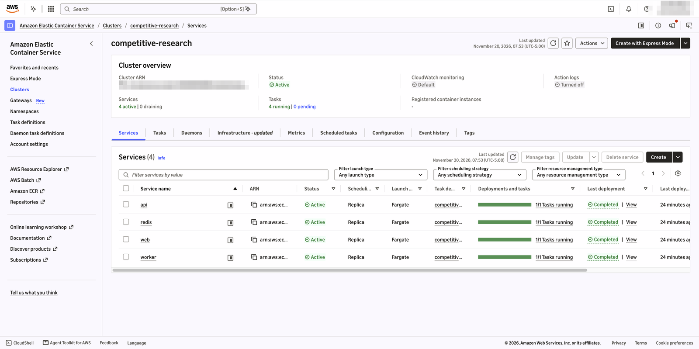

<details>
<summary>More from the deployment</summary>

The web app served from the load balancer:

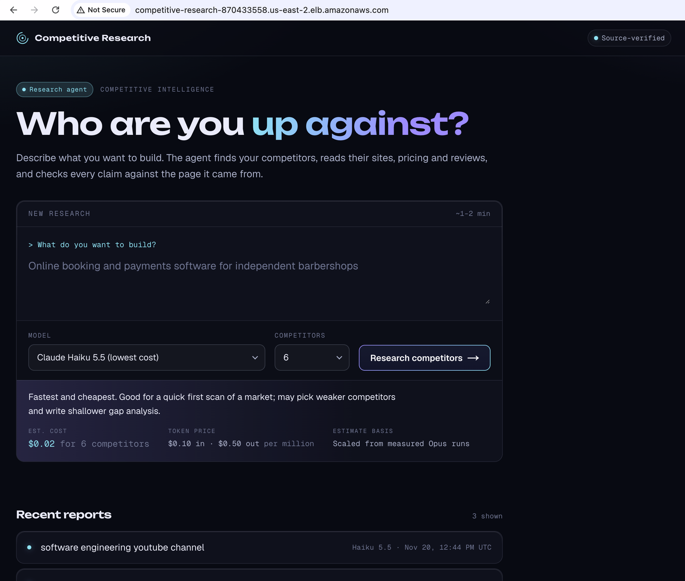

Competitor claims with sources:

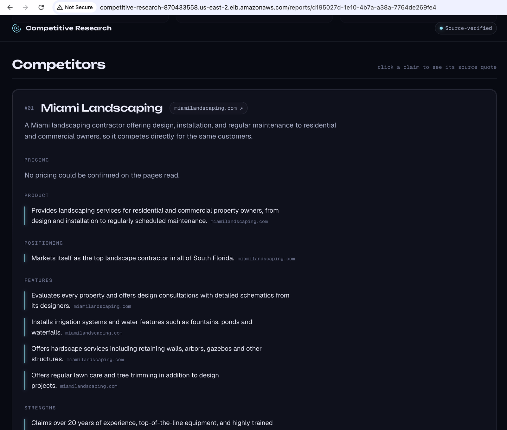

The load balancer target is healthy:

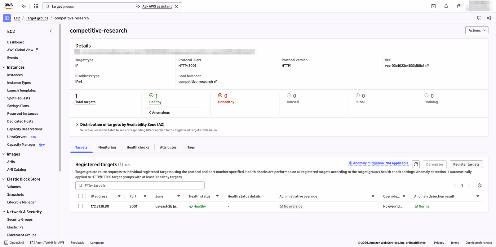

RDS PostgreSQL:

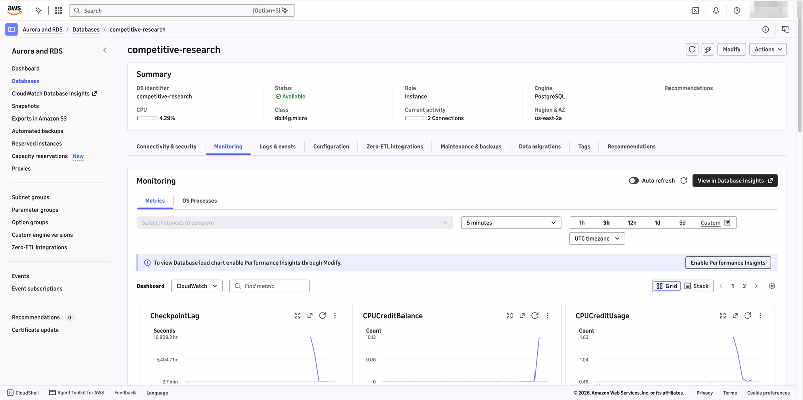

The API service on ECS:

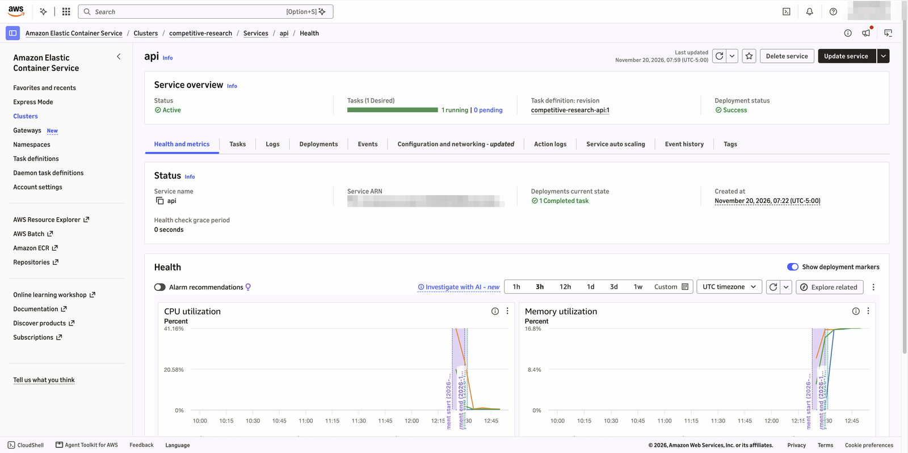

API logs in CloudWatch:

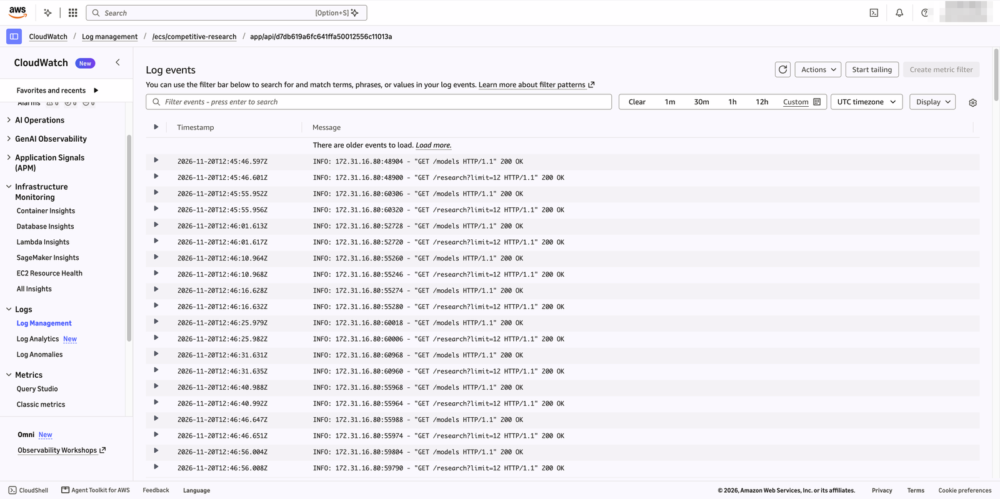

</details>

## Using it from Claude (MCP)

The MCP server exposes `start_research`, `get_research`, `get_report`, `list_research` and `list_competitors`. Read-only tools are marked as such. The server's instructions tell Claude to confirm the model and cost with the user before starting a paid run, and to reuse existing reports.

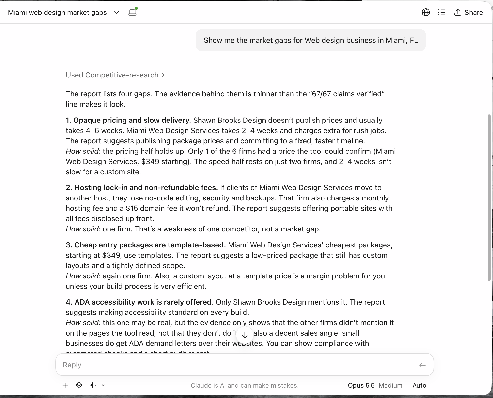

<details>
<summary>More from Claude Desktop</summary>

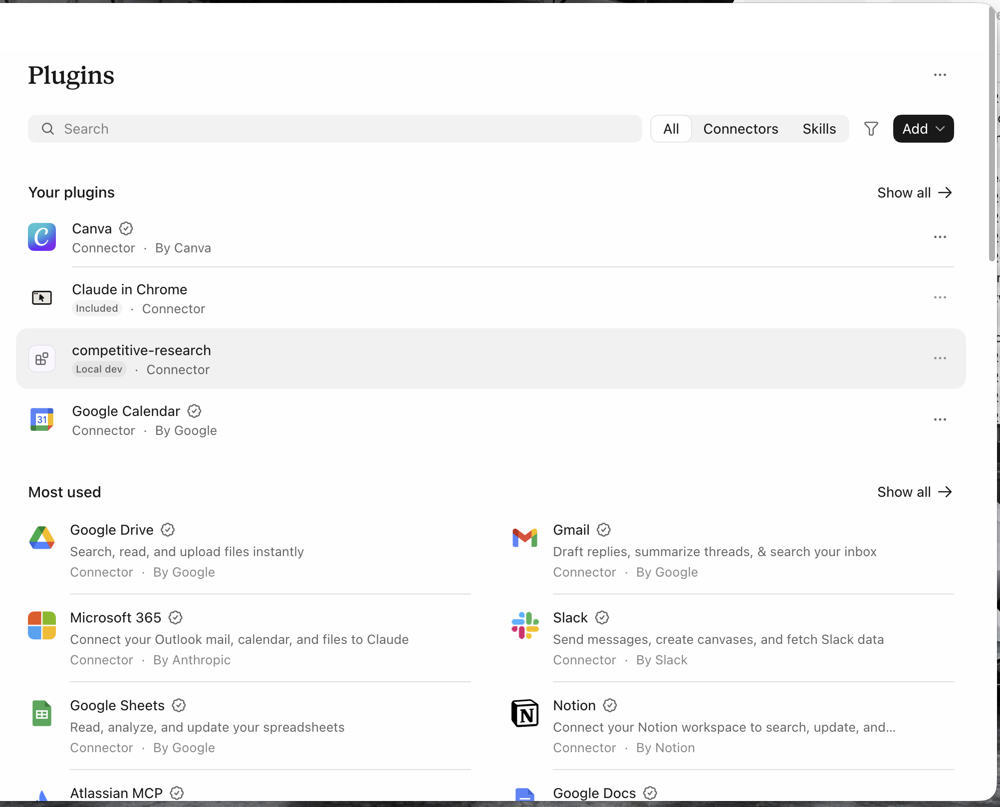

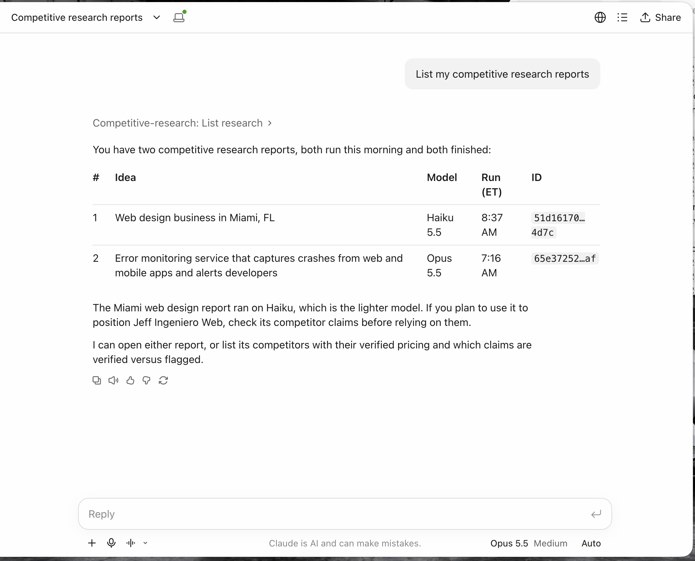

</details>

## Limitations and next steps

This is a portfolio project, not a production service:

- **No authentication.** The AWS deployment relies on an IP allow-list and plain HTTP. A real deployment needs a login (for example Cognito on the ALB), OAuth on the MCP endpoint, HTTPS and a per-user spend cap.
- **Citation support is 0.555.** Claims bundle several facts behind one quote. Next: make the extraction step write one fact per claim and re-run the eval.
- **Recall is 0.568 and misses market leaders.** Next: add a "known leaders" search before selection.
- **The eval is noisy for recall.** Recall varies widely between cases (±0.145 at 15 cases × 1 rep). Measuring smaller changes needs more reps or cases.
- **Haiku and Sonnet aren't evaluated.** Their costs are estimates scaled from Opus, and their quality isn't measured yet.
- **Gaps in the tooling:** Exa cost isn't tracked, there's no CI pipeline yet, Langfuse isn't part of the cloud deployment, and page text is capped at 15,000 characters.

## Repository map

| Path | What's there |
| --- | --- |
| `src/app/research/` | Agent: graph, prompts, verification, Exa search, page cache, model list, telemetry |
| `src/app/routes/`, `src/app/main.py` | FastAPI app |
| `src/app/tasks.py` | Celery task |
| `src/app/models.py`, `src/app/repository.py`, `src/migrations/` | Database schema, persistence, Alembic migrations |
| `src/app/mcp_server.py` | MCP server |
| `src/evals/` | Eval cases, runner and grading |
| `src/tests/` | Offline test suite |
| `web/` | Next.js frontend |
| `infra/aws/`, `scripts/aws.sh` | Terraform and the deploy, status and teardown script |
| `infra/langfuse/` | Self-hosted Langfuse (Compose profile) |
| `docs/` | Running guide, diagrams (D2 sources and SVGs), screenshots |
| `.claude/hillclimb/research-report/` | Eval results and metric definitions |
| `loadtest/` | k6 load test (read endpoints only) |
